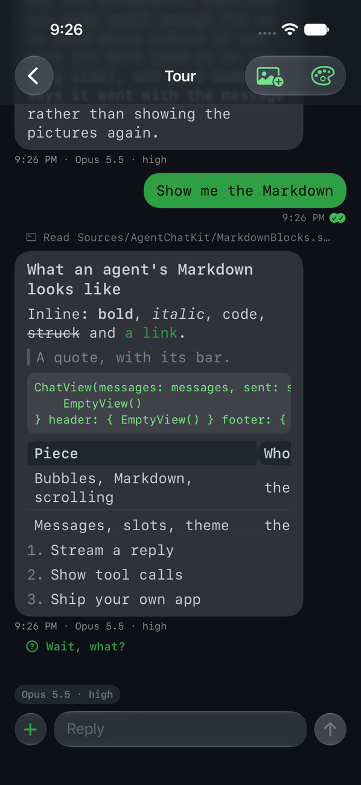

# AgentChatKit

> The chat with a coding agent, as a Swift package: one screen, its bubbles, its field and its attachments, for every
> app that talks to an agent.

PRHub's Ask AI, Agent Pager's threads and chats, and [FeedbackKit](https://github.com/jai/feedbackkit) all draw their
chats with it. It knows nothing of pull requests or of any app's Worker: a host turns its own conversation into
`ChatMessage`s and gives the slots what only it has.

## Products

| Product | What it holds | Imports |
|---|---|---|
| `AgentChatCore` | `MessageImage` (a screenshot as a Worker takes it) and `ScreenshotLine` | Foundation. Safe in an app extension. |
| `AgentChatKit` | `ChatView`, `ChatMessage`, `SessionBubble`, `SessionComposer`, `ComposerAttachments`, `ModelReasoningChip` and `ModelPicker`, `DeliveryTicks`, `ChatQuickReply` and `WaitWhatButton`, `MarkdownText`, `ChatScroll` and `followsChatEnd`, `ReturnKey`, `Pasteboard`, `FoldSet`, `ChatStyle`, `ChatTheme` | SwiftUI, and `AgentChatCore`, re-exported. |
| `AgentChatLive` | `LiveChatModel` follows a chat live ([protocol](docs/live-protocol.md)): stream, reconnect with back-off, read while down, one cursor, the writes; `LiveChat` and its `chatMessages` | `AgentChatKit`, [DurableNetworking](https://github.com/jai/durable-networking) |
| `AgentChatLiveTesting` | `LiveLoopbackServer`: the protocol's server in memory, for tests, previews and demos | `AgentChatLive` |
| `@jai/agentchat-live` (npm, [`server/`](server/README.md)) | The protocol's server for a Cloudflare Worker: `<base>/acp`, the room Durable Object, replay and broadcast; a conformance suite every host runs; an in-memory host | none; installed from each release's tarball |

## Use it

```swift
.package(url: "https://github.com/jai/agentchatkit", from: "0.1.0")
```

```swift
ChatView(messages: messages, sent: sentCount, readsEnd: $readsEnd, focus: $focused) { _ in
    EmptyView()
} header: {
    EmptyView()
} footer: {
    EmptyView()
} composer: {
    SessionComposer(draft: $draft, isSending: isSending, send: send, focused: $focused)
}
```

## Theme

A chat takes its fonts, colours and icons from `ChatTheme`, set once at the host's root:

```swift
RootView().chatTheme(ChatTheme(font: { .app($0) }, toneGood: .green))
```

With none, `ChatTheme.standard` draws the system's: Dynamic Type on the phone, the Mac's sizes times its View menu's
text size (`macTextScale`), the system's grounds, and the host's `ToneGood` and `ToneBad` colour sets. The chat's own
measures (a bubble's insets, its widest share of a wide window) are `ChatStyle`'s.

## Demo

`Demo/` is an iPhone and Mac app that shows the chat at work with a scripted agent: replies that stream in
Markdown after quiet tool-call rows, the working line, delivery ticks, "Wait, what?", screenshots sent from the reply
box, the model and reasoning chip, a long chat that keeps to its end, three themes set by the host (PR Hub,
Terminal, Paper), and a Live chat followed with AgentChatLive, whose toolbar drops the stream or takes the network away
to show it reconnect. Everything runs in the app: no network, no account.

<p>
  
  
  
</p>

```sh
cd Demo && xcodegen && open AgentChatDemo.xcodeproj
```

Run `AgentChatDemo-iOS` or `AgentChatDemo-macOS`. The package is a local dependency, so a change in `Sources/` shows in
the demo at once. Launch arguments set it up: `-DemoChat tour|long|live`, `-DemoTheme prHub|terminal|paper`, and
`-DemoPace fast|slow` for the agent's speed.

## Develop

`swift test`. Swift 6, iOS 26 and macOS 26.

The demo is this repo's UI-test host: `AgentChatDemo-iOS`'s tests (`Demo/UITests`) walk the main flows on an iPhone, and
`testReadmeScreenshots` takes the pictures above (they are kept on its test result).
