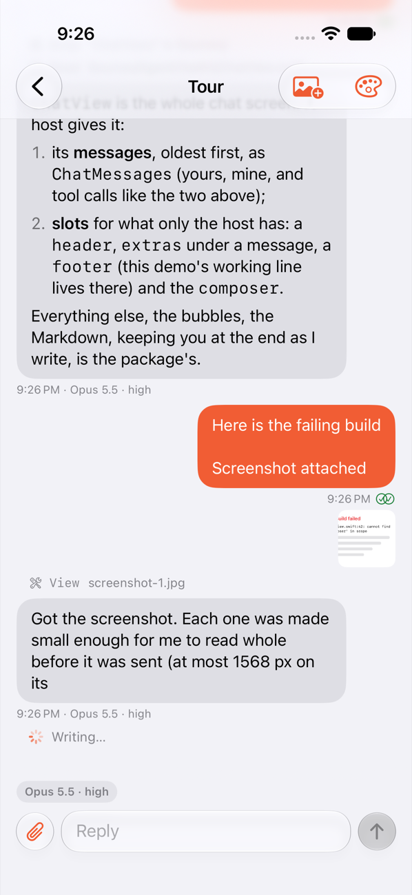
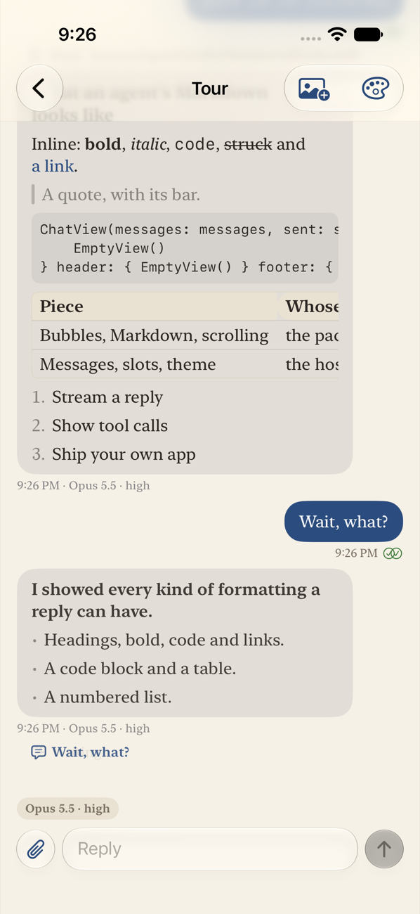

# AgentChatKit

> The chat with a coding agent, as a Swift package: one screen, its bubbles, its field and its attachments, for every
> app that talks to an agent.

PRHub's Ask AI, Agent Pager's threads and chats, and [FeedbackKit](https://github.com/jai/feedbackkit) all draw their
chats with it. It knows nothing of pull requests or of any app's Worker: a host turns its own conversation into
`ChatMessage`s and gives the slots what only it has.

## Products

| Product | What it holds | Imports |
|---|---|---|
| `AgentChatCore` | `MessageImage` (a screenshot as a Worker takes it) and `ScreenshotLine` | Foundation. Safe in an app extension. |
| `AgentChatKit` | `ChatView`, `ChatMessage`, `SessionBubble`, `SessionComposer`, `ComposerAttachments`, `ModelReasoningChip` and `ModelPicker`, `DeliveryTicks`, `ChatQuickReply` and `WaitWhatButton`, `MarkdownText`, `ChatScroll` and `followsChatEnd`, `ReturnKey`, `Pasteboard`, `FoldSet`, `ChatStyle`, `ChatTheme` | SwiftUI, and `AgentChatCore`, re-exported. |
| `AgentChatLive` | `LiveChatModel` follows a chat over [our ACP v2 profile](docs/live-protocol.md): initialize, the session stream, resume from a cursor, reconnect with back-off, the writes (send, edit, send now, remove) and the agent's questions; `LiveChat` and its `chatMessages` | `AgentChatKit`, [DurableNetworking](https://github.com/jai/durable-networking) |
| `AgentChatLiveTesting` | `LiveDevHost`: one session on the server package's real ACP host on localhost (`server/dev/host.ts`), as a transport with the host's test knobs; on the Mac it starts the host with `node` | `AgentChatLive` |
| `@jai/agentchat-live` (npm, [`server/`](server/README.md)) | The protocol's server for a Cloudflare Worker: `<base>/acp`, the room Durable Object, replay and broadcast; a conformance suite every host runs; an in-memory host | none; installed from each release's tarball |

## Use it

```swift
.package(url: "https://github.com/jai/agentchatkit", from: "0.1.0")
```

```swift
ChatView(messages: messages, sent: sentCount, readsEnd: $readsEnd, focus: $focused) { _ in
    EmptyView()
} header: {
    EmptyView()
} footer: {
    if isWorking { ChatWorkingLine(activity: activity) }   // "Searching threads…", identifier chat-working
} composer: {
    SessionComposer(draft: $draft, isSending: isSending, send: send, focused: $focused)
}
```

Each message is one accessibility element, `chat-message-you-<id>`, `chat-message-agent-<id>` or `chat-message-tool-<id>`
(`ChatMessage.accessibilityIdentifier`). `.chatMessageContent(when:content:)` lets the host draw the messages it claims
inside the kit's bubble (link cards, a meal card); the rest stay Markdown.

Around the chat, `ChatStatusLine(_:tone:systemImage:action:identifier:)` is one line of status in the header, footer or
composer slot: a problem with Retry, an agent offline, a send error, or a context chip with Clear. `ChatCostLine(spent:
limit:)` reads "$0.42 so far, of $2".

## Theme

A chat takes its fonts, colours and icons from `ChatTheme`, set once at the host's root:

```swift
RootView().chatTheme(ChatTheme(font: { .app($0) }, toneGood: .green))
```

With none, `ChatTheme.standard` draws the system's: Dynamic Type on the phone, the Mac's sizes times its View menu's
text size (`macTextScale`), the system's grounds, and the host's `ToneGood` and `ToneBad` colour sets. Bubble geometry
remains in `ChatStyle`. Shared thread/queue/question/status/screenshot spacing uses `ChatTheme.spacing`.

The new pieces use four semantic roles: `meta` (context/status/chips), `objectTitle`, `body` (About/queue words), and
`control`. Each accepts the host font, font leading and line spacing; none picks a fixed point size. Unset roles
continue to resolve through the current `theme.font` closure, including later mutations of that closure. Nil
leading/lineSpacing preserve the font’s own leading and inherited line spacing:

```swift
var theme = ChatTheme(font: { .app($0) }) // existing hosts keep this initializer
// Map the host's Graphical metrics here; these system styles illustrate the shape.
theme.typography = ChatTypography(
    meta: .init(font: .caption, lineSpacing: 2),
    objectTitle: .init(font: .headline, leading: .tight),
    body: .init(font: .body, lineSpacing: 6, leading: .loose),
    control: .init(font: .body.weight(.semibold))
)
theme.spacing = ChatSpacing(xs: 4, sm: 8, md: 12, lg: 16,
                            rowInsets: EdgeInsets(top: 4, leading: 16, bottom: 4, trailing: 16))
theme.controlSize = .large // native semantic size; hosts may use .regular on Mac
```

Host accessory/chip views can also use `.chatTextStyle(.meta)` or the other roles. Explicit fonts on their own
children still take precedence. Hosts own any scaling of custom line-spacing/spacing tokens.

Existing `DeliveryTicksLine` and `WaitWhatButton` keep their caption2 and semibold footnote fonts until the host supplies the corresponding semantic role. New chat controls use the semantic defaults.

## Thread rows and navigation

`ChatThreadRow` orders context (`meta`), object title, `About:` body text, then chips. Its optional `titleMark`
ViewBuilder sits immediately before the title. Status sits at the right of the context's **first baseline**, or the
title's first baseline when context is nil/empty. Text wraps at Dynamic Type sizes rather than being truncated.
The original two-slot initializer remains available; add the third slot when adopting a mark:

```swift
ChatThreadRow(title: thread.title, context: thread.context, about: thread.summary,
              identifiers: .init(row: "thread-line", title: "thread-title")) {
    HostAppMark(thread: thread) // titleMark
} accessory: {
    HostStatusAccessory(thread: thread)
} chips: {
    HostChips(thread: thread)
}
```

Hosts can wrap a row in their own navigation or use the native list:

```swift
NavigationStack {
    ChatThreadList(items: threads, title: \.title, actions: { thread in
        ChatThreadActions(archive: {
            hideLocally(thread.id)
            return .success(())
        })
    }) { thread in
        ChatThreadRow(title: thread.title, context: thread.context, about: thread.summary) {
            HostStatusAccessory(thread: thread)
        } chips: {
            HostChips(thread: thread)
        }
    } destination: { thread in
        HostConversation(thread: thread)
    }
}
```

`chatThreadActions(title:actions:)` also attaches these actions to a host-owned row. Nil hooks omit their controls.
Archive calls the supplied hook; local hiding is a host policy. Delete presents a confirmation, then invokes the
host's hook. Both hooks return `Result<Void, ChatActionError>`, disable the row while awaiting completion, and show
host errors without removing the row. Menu, trailing phone swipe (without full swipe), and Mac Delete all use the
same tagged action controller per item ID: idle, confirming delete, pending operation, or failed operation. A
confirmation, pending hook, or error cannot be replaced by a competing action. Right-click on Mac and long-press
on phone share the same hooks. The kit implements no vendor archive/delete endpoint. `ChatActionError`
lives in `AgentChatCore` and is re-exported by `AgentChatKit`.

Host actions can keep an existing Pin/Open menu with `ChatThreadActions(archive: archive, delete: delete).menuItems { existingHostMenu }`. These items join Archive/Delete in the context menu; the shared swipe and Delete-key actions retain their host hooks.

When a host already owns route values or a selected detail column, use the list's header/footer initializer. Its row
closure contains the host's own `NavigationLink(value:)` or selection button, so returning to the list and restoring
drafts remain host-owned. Header and footer hold its starting, empty and error states. The list uses native `List`
rows and selection. It does not keep a second navigation path or register any
`navigationDestination(for:)`, including for the host's `Item.ID` type:

```swift
ChatThreadList(items: threads, title: \.title, actions: hostActions,
               selection: $selectedThreadID, open: openThread) { thread in
    NavigationLink(value: HostRoute.thread(thread.id)) { hostRow(thread) }
} header: {
    startingOrNewThread
} footer: {
    emptyOrErrorState
}
```

Both initializers accept optional `selection: Binding<Item.ID?>` and `open: (Item) -> Void`. On Mac, native arrows
change selection and Return invokes `open` for the selected row. The host callback owns opening a detail column or
updating its navigation path. A host may instead render a selection button; on Mac an undecorated row also uses
native List selection. Without `open`, Return remains available to native navigation. Delete requests the selected
row's host delete hook through the same confirmation/pending/error state as its row menu. Missing delete hooks do
nothing. Selection clears when its item leaves the supplied collection. Do not also attach `chatThreadActions` to a
row inside `ChatThreadList`; the list already owns its controller. The convenience destination initializer supplies
a native disclosure indicator, so its row should not add an explicit navigation chevron.

`Demo/Sources/DemoHostThreadList.swift` demonstrates a host route of type `String` (also its item-ID type),
header/footer, external selection and Return callback. FeedbackKit can keep its current row/header/footer closures
and add just `selection:`/`open:`; its host still owns routes. A host NavigationLink uses the native list disclosure.

See [the adoption review handoff](Demo/ADOPTION.md) for authored coverage, screenshot output and files changed.

## Reply queue

Own one `ReplyQueueController<ID>` per conversation. Map server snapshots into `QueuedReply<ID>` with stable IDs,
client refs, creation dates, delivery states, exact status wording, and `actionPending` for an accepted action still
in progress. Only `.inThreadQueue` appears in the strip, oldest first; local outbox `.queued` stays with the host.

```swift
let queue = ReplyQueueController<String>(remove: { reply in
    await host.removeQueuedReply(reply.id) // Result<QueuedReply<String>?, ChatActionError>
}, sendNow: { reply in
    await host.sendQueuedReplyNow(reply.id)
})

// Above the host's composer; bind its draft to queue.draft.
ThreadQueuedReplies(model: queue, interrupts: host.sendNowInterrupts)

// Record the composer's intent before submission, using the reply's stable client ref:
queue.sendNowWhenQueued(clientRef: clientRef)

// When a host snapshot arrives:
queue.replaceReplies(mappedReplies)
await queue.sendNowWhereQueued()
```

Each hook returns the updated authoritative reply with the same ID, or nil when it leaves the queue. A successful
Remove must mean the host accepted removal and it is safe to put its words back in the draft. If removal is still
pending, return that reply with `actionPending: true`. Edit prepends only after success, preserving words typed during
the request. A failure leaves the draft alone and appears on the row; return a user-facing `ChatActionError`.
Concurrent actions for the same reply are rejected while awaiting a hook or while `actionPending` is true.

Queue controls use full icon-and-word native buttons: pencil Edit and red bin Remove on the left, prominent Send
now on the right (red when it interrupts). Controls use the host control role/size and reflow when space is tight.

Omit the Send now hook to omit its button. `interrupts` comes from host capabilities; the kit never assumes that
sending stops a turn. Composer intents are consumed before the first request, including on failure, and repeated
snapshots cannot automatically send them again. An explicit button tap can retry a failed request. Intent tracking
lasts for the controller's lifetime; hosts own durable outbox/restart behavior and discard controllers with their
conversation. Polling, routing, server refreshes and cancellation of network requests stay in the host.

## Delivery status and questions

Map the host's delivery model to `ReplyDeliveryState`. `.pending(attempts: 0)` and `.delivering` draw one sent tick;
`.delivered` draws two. `.queued`, retrying `.pending(attempts: 1)` (or more), `.inThreadQueue`, `.failed`, `.removed`
and `.other` draw the host's exact status text without ticks. `SentReplyStatus` takes optional Retry/Cancel callbacks
and `isSending`; the host owns those operations, errors and updated state. Existing `DeliveryTicks` APIs are unchanged.

```swift
SentReplyStatus(state: .failed, text: "Connection lost", about: reply.text,
                isSending: retrying, retry: retry, cancel: cancel)

// Option is the host's Identifiable type; its full payload reaches the callback.
ThreadQuestion(question: ask.question, context: ask.context, options: ask.options,
               isSending: answering, label: \.label, answer: sendAnswer,
               reply: openComposer, waitWhat: { send(ChatQuickReply.waitWhat.text) })
```

Question/context and callbacks are optional. Answer buttons share equal emphasis and width, sit side by side when
the longest fits on one line, and stack when it cannot. All answer/Reply/Wait, what? controls respect `isSending`.
Use `showsQuestion`/`showsContext` when another part of the host already says those words.

## Sent screenshots

```swift
SentScreenshotStrip(key: reply.clientRef) { key in
    await host.loadSentJPEGs(key) // Result<[Data], ChatActionError>, ordered as sent
}
```

A strip opens its own viewer on tap. For one viewer shared by a conversation's strips, own a
`SentScreenshotViewing` and add `.presentsSentScreenshots(viewing)` to the conversation. The viewer uses a full-screen
cover on iOS and a sheet on Mac; Close or a downward swipe dismisses it. JPEG loading is asynchronous and decoding
runs off the main actor. Unreadable images are skipped while keeping original indexes and stable key/index IDs;
load failures show the host's error. Changing the key cancels the old image load. Persisting files, mapping
client refs to server reply IDs and refresh policy remain host responsibilities.

All new shared pieces accept identifier configurations without a long list of initializer arguments:

- `ChatThreadRowIdentifiers`: row, context, title, titleMark, About, status slot, chips slot. Nil slot IDs apply no
  modifier, preserving explicit IDs on host views.
- `ChatThreadActions.identifiers`: `ChatThreadActionIdentifiers` for archive/delete, confirm/cancel, error OK, pending.
- `ThreadQueuedReplies(..., identifiers: { reply in QueuedReplyIdentifiers(...) })`: per-reply row, text, status,
  Edit/Remove/Send now, using stable host IDs.
- `SentReplyStatus(..., identifiers: ReplyStatusIdentifiers(retry: "finder-message-retry"))`: status, sent/delivered
  ticks, Retry/Cancel. Standalone `DeliveryTicksLine` and `WaitWhatButton` also accept `identifier:`.
- `ThreadQuestion(..., identifiers: ThreadQuestionIdentifiers(answer: { "answer-\($0)" }, reply: "question-reply"))`:
  question/context, per-option answer, Reply, Wait what.
- `SentScreenshotIdentifiers`: thumbnail key/original index closure, viewer, Close. Pass to a strip or a direct viewer.
  A shared `.presentsSentScreenshots(viewing, identifiers: ids)` override takes precedence over the selected strip;
  otherwise each strip carries its viewer IDs into either local or shared presentation.

The original accessibility identifiers remain `queued-reply`, `reply-status`, `reply-ticks-1`, `reply-ticks-2`,
`wait-what`, `sent-screenshot`, `sent-screenshot-viewer`, and `sent-screenshot-viewer-close`.

## Adoption boundary

These are additive APIs. App originals need not change until their host adopts a released package. Host-specific
ChatLinks, Finder, food, transport models and screenshot persistence stay outside the kit. A later adopter maps
its statuses and callbacks, keeps navigation in the host, and supplies only capabilities it actually supports.

## Demo

`Demo/` is an iPhone and Mac app that shows the chat at work with a scripted agent: replies that stream in
Markdown after quiet tool-call rows, the working line, delivery ticks, "Wait, what?", screenshots sent from the reply
box, the model and reasoning chip, a long chat that keeps to its end, three themes set by the host (PR Hub,
Terminal, Paper), and a Live chat followed with AgentChatLive over ACP, whose toolbar drops the stream or takes the network
away to show it reconnect, and whose agent asks before it merges. Everything runs in the app: no network, no account.

<p>
  
  
  
</p>

```sh
cd Demo && xcodegen && open AgentChatDemo.xcodeproj
```

Run `AgentChatDemo-iOS` or `AgentChatDemo-macOS`. The package is a local dependency, so a change in `Sources/` shows in
the demo at once. Launch arguments set it up: `-DemoChat tour|long|live`, `-DemoTheme prHub|terminal|paper`, and
`-DemoPace fast|slow` for the agent's speed. Deterministic standalone fixtures accept
`-DemoFixture row|threads|host-threads|host-routes|queue|delivery|question|screenshots|screenshots-local`,
`-DemoAppearance light|dark|large` and `-DemoCustomIDs YES|NO`. They use host semantic typography and line spacing;
large text uses accessibility Dynamic Type on phone and larger semantic host fonts on Mac.

The sidebar's **Shared pieces** (or `-DemoChat extraction`) opens independent fixtures for the shared thread list,
queue, delivery status, question and sent screenshots. They show host callback counts, deliberate failures,
pending/disabled controls and repeated queue snapshots without changing the scripted tour. `ExtractionUITests`
drives Archive/Delete and confirmation cancellation, queue Edit/Remove/Send now, Retry/Cancel, all question callbacks,
adaptive answer stacking and screenshot viewer Close/swipe-down. Package unit tests cover queue failure/success,
ordering and concurrent/send-once behavior, delivery tick mapping, and image decode/order/orientation.

`AdoptionUITests` runs on both platforms and captures each piece plus the viewer in light, dark and large text.
Screenshots are actual `XCUIScreen` renders, retained as test attachments and written to `CHATDEMO_SCREENSHOTS` when
provided, named `ios-<fixture>-<appearance>.png` / `macos-<fixture>-<appearance>.png`. The Mac UI-test bundle/target is
`AgentChatDemoMacUITests`, included in scheme `AgentChatDemo-macOS`. Its extra suite drives arrows/Return/Delete and
right-click. These new tests and captures have been authored but not executed/generated in the delegated adoption
step; the parent owns the permitted CI run and rendered-image review.

## Develop

`swift test`. Swift 6, iOS 26 and macOS 26.

Never breaking (Jai, 2026-11-16): apps take every release, so the public API only grows. Add, never remove a public
declaration or change its signature; to replace one, add the new one and mark the old `@available(*, deprecated)`. A
deliberate break needs Jai's OK first and a major version. `swift package diagnose-api-breaking-changes <latest release
tag>` must find no break; CI's `api` job checks it and a release waits for CI.

The demo is this repo's UI-test host: `AgentChatDemo-iOS`'s tests (`Demo/UITests`) walk the main flows on an iPhone, and
`testReadmeScreenshots` takes the pictures above (they are kept on its test result).


## Shared controls for ACP live chats

Import `AgentChatLive` as well as `AgentChatKit`. The adapters live in AgentChatLive, which depends on the generic
renderers; AgentChatKit has no reverse dependency. Own one `LiveChatControls(live: model)` per chat. It retains only
request busy/error state. Messages, queue, working state, questions and attachments come from `model.chat`.

```swift
LiveQueuedReplies(controls: controls, draft: $draft, identifiers: queueIDs)
LiveReplyStatus(controls: controls, messageID: message.id, identifiers: statusIDs) // Built-in live Retry/Cancel.
// Optional host Retry override: add retry: host.retryFailedReply.
LiveQuestionView(controls: controls, identifiers: questionIDs)
LiveScreenshotStrip(live: model, messageID: message.id, identifiers: pictureIDs,
                    load: host.loadAttachment)
```

Use `model.conversationMessages` with the strip: only `.queued` goes above the composer, once, in LiveChat's existing
`at` order. The existing `chatMessages` projection retains queued bubbles for compatibility. Pending and delivering
remain in the conversation; removed replies are absent. `state?.working` is the agent's authoritative working state.

For `ChatView.extras`, mark the relevant `ChatMessage.hasExtras = true` to bypass its bare-bubble equality shortcut.
When drawing `LiveReplyStatus` there, clear that projected user's `ticks` and `date` so its ticks/time render once;
leave nil-status external messages' date on the bubble. The demo's `DemoLiveScreen.messages` shows this mapping.
Other hosts may keep projected ticks and add only their own failed status/actions.

Edit calls `live.remove` and prepends the explicitly removed record's words to the **current** draft. A lost RPC
reply still permits restoration when the stream confirms `.removed`; absence in a capped snapshot never does.
Remove/Cancel accept pending, queued or failed and use `live.remove`. Queued Edit/Send now remain limited to
pending/queued; Send now calls `live.sendNow` (force-only edit). Failed Retry defaults to `live.retry`: force-only edit
returns the same message to pending with the same ID/clientRef. An optional host Retry callback overrides that RPC.
Delivering/delivered Cancel is absent. No completion overwrites live messages/queue or displays an old request error
above newer delivery/removal. `controls.errors` exposes request errors only for their unchanged actionable status.

Single-choice questions without free text send on tap. Questions allowing text or multiple choices retain local
selection/text until Submit; choices go in schema order. `controls.answer(question, options:text:)` and
`controls.decline(question)` are separate methods and share request busy/error handling. A refused Decline leaves the
question open. `LiveQuestionView.ChoiceBehavior.automatic` follows that schema-based behavior; `.immediate` sends a
single choice on tap, including composed text. Multiple choices still use Submit. Set `choiceBehavior: .immediate`
for that flow; the original Live demo opts in. Request identity resets selection/text.

`LiveAttachmentLoader` is `@Sendable (LiveAttachment) async -> Result<Data, ChatActionError>`. The host resolves
relative URIs against its ACP endpoint, applies/renews authentication where appropriate, and returns image bytes or a
safe user-facing error. This package does not infer credential or signed-URL policy. Never put a URI into IDs/logs.
Image resources load in message content order; unsupported MIME types and undecodable slots retain their original
indexes. A streamed attachment change cancels/reloads the strip for the same message id. The existing local/shared
`SentScreenshotViewing` viewer and every `SentScreenshotIdentifiers` override are reused.

Deterministic live fixtures run on the server package's dev host (`node server/dev/host.ts --port 8788`, through
`LiveDevHost`), not polling or independent UI snapshots. Launch with
`-DemoFixture live-queue|live-status|live-status-override|live-question-single|live-question|live-question-immediate|live-question-multiple|live-question-text|live-screenshots|live-screenshots-local`.
The both-platform `LiveControlsUITests` author interactions and real XCUIScreen light/dark/large captures using the
existing capture infrastructure. See [Demo/ADOPTION.md](Demo/ADOPTION.md) for the exact handoff and validation limits.
