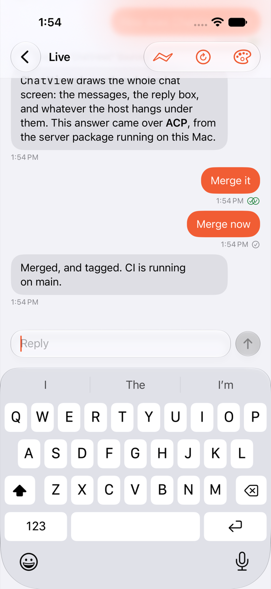

# End-to-end walk-through

The live chat, end to end, on 2026-11-15, on Borg Cube 03: the demo app on an iPhone 17 Simulator (iOS 27.2) of this
walk's own (`agentchatkit-live`, headless, deleted afterwards), following a **real ACP host**: the server package
(`server/`) behind `Demo/server/dev-host.ts`, over HTTP on the same Mac. Before apps adopt AgentChatLive and
`@jai/agentchat-live`, this is the run that shows them working together.



## How it works

- **Nothing is faked between the two.** The app uses `LiveChatModel` on DurableNetworking's `URLSessionTransport` and
  `URLSessionStreamingTransport`, as an app does. The host is the package's `handleAcp` and `LiveRoom` over its
  in-memory sessions (`@jai/agentchat-live/memory`), with a scripted agent writing to the session as a host would.
- **The host's control routes stand in for the world:** `/control/drop` ends every stream (a lift, a network change),
  `/control/restart` forgets every connection (a deploy), `/control/expire` makes every cursor stale.
- **The UI test is the script:** `testLiveChatAgainstARealHost` (`Demo/UITests`) drives it and keeps each reconnect's
  time on its result. It skips without a host, so CI runs only the in-memory Live chat test.

Run it yourself:

```sh
node Demo/server/dev-host.ts &               # http://127.0.0.1:8788/acp, session "live", bearer "token-jai"
cd Demo && xcodegen
TEST_RUNNER_DEMO_SERVER=http://127.0.0.1:8788/acp xcodebuild test -project AgentChatDemo.xcodeproj \
  -scheme AgentChatDemo-iOS -destination "id=<your simulator>" \
  -only-testing:AgentChatDemoUITests/DemoUITests/testLiveChatAgainstARealHost
```

Or by hand: launch the app with `-DemoChat live -DemoServer http://127.0.0.1:8788/acp` and use the toolbar.

## The run

The host's log, from the final run (1 test, passed, 26 s):

```
06:54:34.420 POST /acp initialize
06:54:34.520 GET /acp stream
06:54:34.539 POST /acp post                    session/resume from start: the greeting, then idle
06:54:41.126 POST /acp post
06:54:41.129 prompt u1: How does ChatView work?
06:54:44.309 control: dropped every stream
06:54:45.462 GET /acp stream                   1 s back-off, then the same connection
06:54:45.465 POST /acp post                    session/resume from its cursor
06:54:46.742 control: restarted (connections forgotten)
06:54:48.639 GET /acp stream                   404: the connection is gone
06:54:48.643 POST /acp initialize              so: initialize again
06:54:48.645 GET /acp stream
06:54:48.647 POST /acp post                    and resume from its cursor
06:54:50.996 prompt u2: Merge it
06:54:52.105 asked q                           elicitation/create; the app shows its buttons
06:54:53.513 answer q1: {"choice":"merge"}
```

What the app showed (its status line, with `LiveConnectTiming.total`):

| When | Status | |
|---|---|---|
| first open | `Live · stream 1 · 718 ms` | initialize, stream, resume from start; the app's first request on a cold start |
| after a dropped stream | `Live · stream 2 · 15 ms` | stream and resume from the cursor, after the first back-off step (1 s) |
| after the host restarted | `Live · stream 3 · 12 ms` | a 404 on the stream, initialize, stream, resume |

Across both reconnects the question the person had sent showed once, its ticks went to two, and the answer that was
being written went on where it was.

## What it found

1. **The stream sat silent for 15 s (fixed in the package).** URLSession holds a response back until it has enough
   bytes to sniff its type; an idle SSE stream sends none until its first keep-alive. The app's `session/resume` waited
   for the stream to open, so every connect took 15 s. The room now sends `X-Content-Type-Options: nosniff` and an
   `: open` comment as soon as a stream starts, and the conformance suite checks both: every host gets the fix. Cloudflare
   would have had the same delay.
2. **The client sent `Acp-Session-Id` only on the stream (fixed in AgentChatLive).** The package rightly refuses a
   session request without it. The client now sends it on everything after `initialize`, the in-memory host refuses
   it too (so the unit tests would have caught it), and a resume that gets no answer drops the stream and reconnects
   instead of waiting on it.
3. **The dev host held headers (Node), not a package bug.** Node's `http` sends headers with the first body write;
   the dev host flushes them. A Worker returns them at once.

## Still to measure

These times are on one Mac's loopback. Reconnect costs four requests (`initialize`, stream, `session/resume`, its
replay); what that costs on a phone in a lift is for Agent Pager to report from real devices (`onTiming`), per
docs/live-protocol.md, "To measure".
